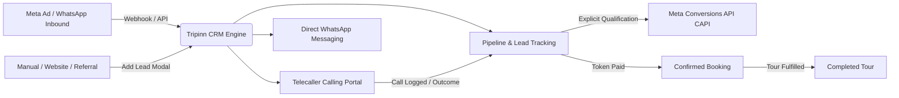
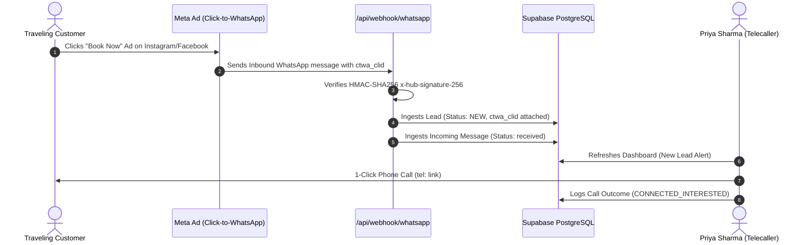
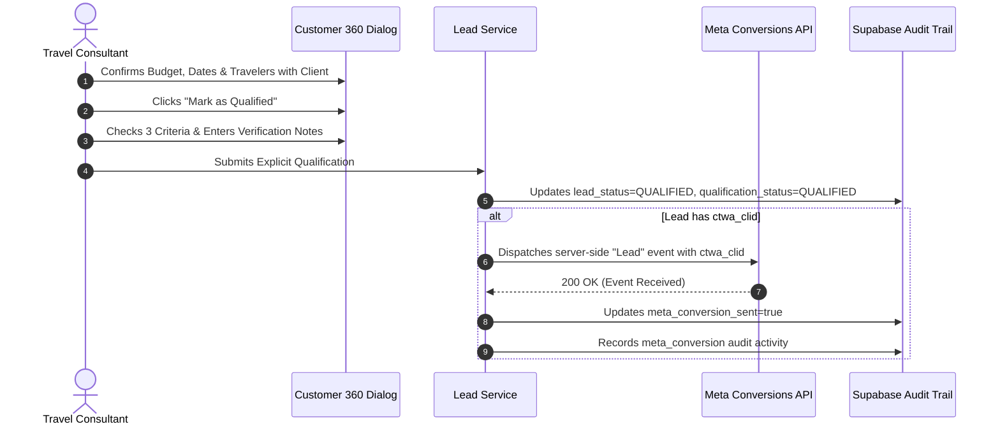

# Tripinn Holidays — WhatsApp & Telecalling CRM
## Comprehensive User Manual & Operations Guide

**Version:** 1.0 (Current Implementation)  
**Target Audience:** System Administrators, Sales Managers, Senior Telecallers, and Travel Consultants  
**Application:** Tripinn Holidays WhatsApp & Telecalling CRM  
**Technology Stack:** Next.js 16 (App Router & Turbopack), Supabase PostgreSQL (RLS), Official Meta WhatsApp Business Cloud API (`v21.0`), Meta Conversions API (CAPI), and SheetJS Excel Reporting.

---

## Table of Contents

1. [Introduction & System Overview](#1-introduction--system-overview)
2. [Access & Login Management](#2-access--login-management)
   - 2.1 [Accessing the Portal](#21-accessing-the-portal)
   - 2.2 [Step-by-Step Login Instructions](#22-step-by-step-login-instructions)
   - 2.3 [Password Recovery Flow](#23-password-recovery-flow)
   - 2.4 [Login Troubleshooting & Error Messages](#24-login-troubleshooting--error-messages)
3. [System Layout & Global Navigation](#3-system-layout--global-navigation)
   - 3.1 [Top Navigation Bar](#31-top-navigation-bar)
   - 3.2 [Left Sidebar Navigation](#32-left-sidebar-navigation)
   - 3.3 [Role Display & Profile Switcher](#33-role-display--profile-switcher)
4. [Agency & Telecaller Dashboard](#4-agency--telecaller-dashboard)
   - 4.1 [Dashboard Header & Global Filters](#41-dashboard-header--global-filters)
   - 4.2 [7 Core Key Performance Indicators (KPIs)](#42-7-core-key-performance-indicators-kpis)
   - 4.3 [Pipeline Stage Funnel Distribution](#43-pipeline-stage-funnel-distribution)
   - 4.4 [Upcoming & Overdue Follow-ups Box](#44-upcoming--overdue-follow-ups-box)
   - 4.5 [Recent Inquiries & CTWA Ads Box](#45-recent-inquiries--ctwa-ads-box)
5. [Module-by-Module Walkthrough](#5-module-by-module-walkthrough)
   - 5.1 [Module 1: Leads & Pipeline Management (`leads`)](#51-module-1-leads--pipeline-management-leads)
   - 5.2 [Module 2: Call Outcome Logger Modal (`CallOutcomeModal`)](#52-module-2-call-outcome-logger-modal-calloutcomemodal)
   - 5.3 [Module 3: Lead Detail Dialog & Customer 360 (`LeadDetailDialog`)](#53-module-3-lead-detail-dialog--customer-360-leaddetaildialog)
   - 5.4 [Module 4: Creating a New Lead (`AddLeadModal`)](#54-module-4-creating-a-new-lead-addleadmodal)
   - 5.5 [Module 5: Telecaller Excel Sheet Export (`TelecallerExportModal`)](#55-module-5-telecaller-excel-sheet-export-telecallerexportmodal)
   - 5.6 [Module 6: Follow-ups & Consultations Queue (`follow-ups`)](#56-module-6-follow-ups--consultations-queue-follow-ups)
   - 5.7 [Module 7: WhatsApp Business Cloud Inbox (`messages`)](#57-module-7-whatsapp-business-cloud-inbox-messages)
   - 5.8 [Module 8: API Integrations & Diagnostics (`settings`) — Admin Only](#58-module-8-api-integrations--diagnostics-settings--admin-only)
   - 5.9 [Module 9: Staff & Team Management (`staff`) — Admin Only](#59-module-9-staff--team-management-staff--admin-only)
6. [End-to-End Operational Workflows](#6-end-to-end-operational-workflows)
   - 6.1 [Workflow 1: Inbound WhatsApp Lead from Meta Ad (CTWA)](#61-workflow-1-inbound-whatsapp-lead-from-meta-ad-ctwa)
   - 6.2 [Workflow 2: Telecaller Daily Calling & Call Outcome Logging](#62-workflow-2-telecaller-daily-calling--call-outcome-logging)
   - 6.3 [Workflow 3: Explicit Lead Qualification & Meta CAPI Event](#63-workflow-3-explicit-lead-qualification--meta-capi-event)
   - 6.4 [Workflow 4: Advancing Booking from Payment Pending to Completed](#64-workflow-4-advancing-booking-from-payment-pending-to-completed)
   - 6.5 [Workflow 5: Managing Overdue Follow-ups & Rescheduling](#65-workflow-5-managing-overdue-follow-ups--rescheduling)
   - 6.6 [Workflow 6: Manual Entry of an Offline or Walk-In Customer](#66-workflow-6-manual-entry-of-an-offline-or-walk-in-customer)
7. [User Roles and Permissions Matrix](#7-user-roles-and-permissions-matrix)
   - 7.1 [Role Definitions: Administrator vs. Telecaller](#71-role-definitions-administrator-vs-telecaller)
   - 7.2 [Feature Access Comparison Table](#72-feature-access-comparison-table)
   - 7.3 [Implemented Features vs. Future Enhancements](#73-implemented-features-vs-future-enhancements)
8. [Error Handling, Validation & Troubleshooting](#8-error-handling-validation--troubleshooting)
   - 8.1 [Phone Number Validation & Normalization Rules](#81-phone-number-validation--normalization-rules)
   - 8.2 [Duplicate Detection & Prevention](#82-duplicate-detection--prevention)
   - 8.3 [WhatsApp Business Messaging Window & Errors](#83-whatsapp-business-messaging-window--errors)
   - 8.4 [Webhook HMAC Signature Verification Issues](#84-webhook-hmac-signature-verification-issues)
   - 8.5 [Supabase Database & Authentication Troubleshooting](#85-supabase-database--authentication-troubleshooting)
9. [Secure Logout Procedure](#9-secure-logout-procedure)

---

## 1. Introduction & System Overview

The **Tripinn Holidays WhatsApp & Telecalling CRM** is an enterprise-grade customer relationship management system specifically tailored for travel agencies handling customized holiday packages, luxury honeymoons, and international group tours.



### Core Capabilities
1. **Automated Inbound Lead Ingestion**: Seamlessly ingests customer inquiries from Meta Click-to-WhatsApp (CTWA) ads, Instagram Direct, Facebook campaigns, website forms, and manual inquiries.
2. **Official Meta WhatsApp Cloud API (`v21.0`)**: Two-way interactive messaging within the CRM interface with live delivery receipts (`sent`, `delivered`, `read`).
3. **Meta Conversions API (CAPI) Integration**: Sends server-side conversion signals (`Lead` event) back to Meta Ads Manager when a travel consultant explicitly verifies that a lead has a confirmed budget, verified travel dates, and verified traveler counts.
4. **High-Velocity Telecaller Portal**: Enables telecallers to execute 1-click calling (`tel:` links), 1-click WhatsApp web chats (`wa.me` links), record call outcomes (`Connected`, `Callback Requested`, `Ringing`, `Busy`, `Not Interested`), and schedule callbacks.
5. **Excel Calling Sheet Export (`.xlsx`)**: One-click download of Microsoft Excel calling workbooks complete with priority flags, direct dial links, travel preferences, and pre-formatted blank notes columns for telecallers.
6. **Role-Based Security**: Strict isolation between **Administrator** operations (full pipeline visibility, API settings, system diagnostics) and **Telecaller / Sales** operations (focused call queue, assigned leads, 1-click outcome logging).

---

## 2. Access & Login Management

### 2.1 Accessing the Portal
- **Local Development URL**: `http://localhost:3000/login`
- **Production URL**: `https://<your-agency-subdomain>.vercel.app/login`
- **Supported Browsers**: Google Chrome, Mozilla Firefox, Microsoft Edge, Safari, and mobile WebKit browsers.

The CRM uses server-side network boundary protection (`proxy.ts`). If an unauthenticated user attempts to visit the dashboard (`/`) or settings (`/settings`), the system automatically redirects them to `/login` with a secure return path parameter (e.g. `/login?next=%2Fsettings`).

```
+-----------------------------------------------------------+
|                      TRIPINN HOLIDAYS                     |
|          Enterprise Travel CRM & Telecalling Portal       |
+-----------------------------------------------------------+
|                                                           |
|  Staff Email Address                                      |
|  [ staff@tripinnholidays.com                           ]  |
|                                                           |
|  Account Password                       Forgot password?  |
|  [ ••••••••••••                                   (👁) ]  |
|                                                           |
|  [ Sign In to Workspace                         -> ]      |
|                                                           |
+-----------------------------------------------------------+
|  🛡️ Authorized personnel only. Public registration         |
|     is disabled to protect client data.                   |
+-----------------------------------------------------------+
```

### 2.2 Step-by-Step Login Instructions

1. Open your browser and navigate to the CRM login page: `/login`.
2. Locate the **Staff Email Address** field. Enter your registered agency email (e.g. `priya@tripinnholidays.com` or `admin@tripinnholidays.com`).
3. Locate the **Account Password** field. Enter your secure password.
   - *Tip*: Click the **Eye icon** (`Show password` / `Hide password`) on the right side of the password field to toggle password visibility and verify accurate entry.
4. Click the green **Sign In to Workspace** button.
5. The system performs a three-tier verification:
   - Validates credentials against Supabase Authentication.
   - Inspects `public.profiles` to ensure a matching staff profile exists.
   - Confirms that the profile status is active (`is_active: true`).
6. Upon successful authentication, you are immediately routed to your designated CRM workspace.

### 2.3 Password Recovery Flow

If a staff member forgets their account password:

1. On the login form, click the green **Forgot password?** link located above the password input.
2. The form smoothly transitions to **Password Recovery Assistance** mode.
3. Enter your registered **Staff Email Address** in the input field.
4. Click **Send Password Reset Link**.
5. The screen displays a green confirmation banner:  
   *`Password reset instructions sent to [email]. Please check your email inbox to set a new password.`*
6. Check your email inbox for an automated reset email containing a secure token link.
7. Click the link in the email to open `/auth/reset-password`.
8. Enter and confirm your new password, then click **Update Password**.
9. The system redirects you to `/login?reset=success` with the message:  
   *`Password updated successfully! Please sign in with your new password.`*

### 2.4 Login Troubleshooting & Error Messages

| Error Banner Displayed | Root Cause | Solution |
| :--- | :--- | :--- |
| **Invalid email address or password. Please verify your staff credentials.** | Typo in email or incorrect password. | Re-enter credentials carefully; check caps lock. Use **Forgot password?** if needed. |
| **Access Denied: Your staff account has been deactivated. Please contact your Tripinn administrator.** | Account exists but `is_active` flag is set to `false` in the database. | Contact your System Administrator to re-activate your profile in `public.profiles`. |
| **Access Denied: No staff profile record exists for this account in public.profiles.** | User exists in Supabase Auth but was not provisioned in the CRM profile table. | Contact System Administrator to insert your profile row with role `'admin'` or `'sales'`. |
| **Email address is not confirmed.** | Supabase project requires email confirmation before first login. | Check email for confirmation message or ask admin to confirm user in Supabase Dashboard. |
| **Please sign in to access the Tripinn Holidays CRM workspace.** | Session expired or direct URL accessed while logged out. | Sign in with your staff credentials. |

---

## 3. System Layout & Global Navigation

The CRM uses a persistent, high-contrast, dual-navigation structure optimized for both desktop widescreen monitors and mobile devices.

```
+---------------------------------------------------------------------------------------------------+
| [TRIPINN CRM]   | Page Title: Travel CRM Agency Dashboard [ADMIN]       [API Online] [Excel] [Add Lead] |
+-----------------+---------------------------------------------------------------------------------+
| Administration  |                                                                                 |
| > Dashboard     |  [ 1. Total Leads ] [ 2. New Leads ] [ 3. Qualified ] [ 4. Follow-ups Due ] ... |
| > Leads         |                                                                                 |
| > Follow-ups    |  Pipeline Stage Funnel:                                                         |
| > WhatsApp      |  [ NEW (4) ] [ CONTACTED (2) ] [ QUALIFIED (3) ] [ FOLLOW_UP (1) ] ...          |
| > Settings      |                                                                                 |
|                 |  +-----------------------------------+  +------------------------------------+  |
| Meta CTWA Ready |  | Upcoming & Overdue Follow-ups     |  | Recent Inquiries & CTWA Leads      |  |
|                 |  +-----------------------------------+  +------------------------------------+  |
| [AD] Admin User |                                                                                 |
| [-> Logout]     |                                                                                 |
+-----------------+---------------------------------------------------------------------------------+
```

### 3.1 Top Navigation Bar
The top navigation bar remains sticky at the top of the interface:
- **Mobile Menu Toggle (Hamburger)**: Displayed on screens under 768px to slide the sidebar in and out.
- **Dynamic View Title & Subtitle**: Adapts dynamically to the active tab and the user's role (e.g. *Travel CRM Agency Dashboard* for Admins vs. *Telecaller Calling Dashboard* for Sales reps).
- **Role Badge**: High-visibility pill indicating either `ADMIN` (emerald badge) or `TELECALLER` (blue badge).
- **WhatsApp Cloud API Health Indicator**: Real-time pulse indicator showing live Meta connectivity.
- **Excel Calling Sheet Button**: One-click launcher for the formatted telecaller spreadsheet export modal.
- **Follow-up Reminder Bell**: Dynamic bell icon displaying the count of due and overdue consultations.
- **Add Lead Button**: Primary green action button that opens the lead creation dialog from anywhere in the app.

### 3.2 Left Sidebar Navigation

| Navigation Item | Role: Administrator View | Role: Telecaller View | Badge Indicator |
| :--- | :--- | :--- | :--- |
| **Dashboard** | `Dashboard & Analytics` | `My Performance` | None |
| **Leads** | `All Leads Pipeline` | `My Calling Leads` | None |
| **Follow-ups** | `Consultations & Follow-ups` | `Today's Call Queue` | Amber badge showing due count |
| **Messages** | `WhatsApp Inbox` | `WhatsApp Inbox` | Emerald badge showing unread count |
| **Settings** | `Integrations & API` | *Hidden (Access Restricted)* | None |

### 3.3 Role Display & Profile Switcher
At the bottom of the sidebar:
- **Avatar Circle**: Two-letter capitalized initials derived from the staff member's name.
- **Full Name & Role Subtitle**: Displays `System Administrator` or `Senior Telecaller / Rep`.
- **Sign Out Button**: Red hover state with a logout icon to securely terminate the authenticated session.

---

## 4. Agency & Telecaller Dashboard

The Dashboard provides immediate operational visibility into lead acquisition, qualification ratios, and daily calling tasks.

### 4.1 Dashboard Header & Global Filters
Located at the top of the dashboard view:
- **Date Range Filter**: Select between `All Time`, `Today`, `Last 7 Days`, `Last 30 Days`, and `This Month`.
- **Source Filter**: Filter metrics by lead acquisition source: `All Sources`, `WhatsApp`, `Instagram`, `Facebook`, `Website`, `Referral`, or `Manual Entry`.
- **Reset Button**: Appears when filters are active, allowing one-click return to defaults.

### 4.2 7 Core Key Performance Indicators (KPIs)

```
+---------------------------------------------------------------------------------------------+
| [ Total Leads ]  [ New Leads ]  [ Qualified ]  [ Follow-ups ]  [ Booked ]  [ Completed ]  [ Rate% ]|
|      18               4               6              3             2             1          16.7%  |
+---------------------------------------------------------------------------------------------+
```

1. **Total Leads**: Total count of all non-archived inquiries across all marketing channels. Clicking this card opens the Leads module with all filters reset.
2. **New Leads**: Fresh inquiries that have not yet been contacted by a telecaller. Clicking this card filters the Leads module directly to `NEW`.
3. **Qualified Leads**: High-intent prospects whose budget, travel dates, and traveler counts have been explicitly verified. Clicking filters to `QUALIFIED`.
4. **Follow-ups Due**: Consultations scheduled for today or past due. Clicking this card navigates directly to the Follow-ups module.
5. **Booked**: Inquiries where the client has agreed to terms and paid the advance booking token. Clicking filters to `BOOKED`.
6. **Completed**: Tours fulfilled and concluded. Clicking filters to `COMPLETED`.
7. **Conversion Rate (%)**: The percentage of total leads successfully converted to bookings:
   $$\text{Conversion Rate} = \left(\frac{\text{Booked} + \text{Completed}}{\text{Total Leads}}\right) \times 100$$
   Includes a visual green-to-teal progress fill bar.

### 4.3 Pipeline Stage Funnel Distribution
A horizontal grid of 8 clickable stage blocks showing active counts:
- **NEW** (Blue) $\rightarrow$ Fresh inquiries.
- **CONTACTED** (Indigo) $\rightarrow$ Initial call or message completed.
- **QUALIFIED** (Emerald) $\rightarrow$ Budget and dates verified.
- **FOLLOW_UP** (Amber) $\rightarrow$ Callbacks scheduled.
- **PAYMENT_PENDING** (Cyan) $\rightarrow$ Advance token invoice issued.
- **BOOKED** (Teal) $\rightarrow$ Token received, reservations secured.
- **COMPLETED** (Green) $\rightarrow$ Tour successfully concluded.
- **LOST** (Rose) $\rightarrow$ Disqualified or opted out.

*Interaction Tip*: Clicking any stage block immediately navigates to the Leads table pre-filtered to that exact stage.

### 4.4 Upcoming & Overdue Follow-ups Box
Displays the top 5 urgent client consultations:
- **Customer Name & Phone Number**: Displays international E.164 phone formatting.
- **Overdue Indicator**: Highlights past-due consultations with a prominent red badge (`Overdue`).
- **Follow-up Agenda**: Displays client requirements or call notes.
- **One-Click "Done" Button**: Immediately marks the follow-up as fulfilled without opening the full profile.
- **Click-to-Inspect**: Clicking the row opens the full Customer 360 dialog.

### 4.5 Recent Inquiries & CTWA Ads Box
Displays the 5 most recently created leads:
- Shows customer name, source channel (`WhatsApp`, `Facebook`, `Instagram`), and a green **Meta Ad** pill if the lead originated from a Click-to-WhatsApp campaign (`ctwa_clid`).
- Displays package interest (e.g. *Bali Honeymoon 7D/6N*) and budget in INR.
- Displays the current pipeline status pill and creation date.

---

## 5. Module-by-Module Walkthrough

### 5.1 Module 1: Leads & Pipeline Management (`leads`)

The Leads module is the command center for lead tracking, search, calling, and status advancement.

```
+---------------------------------------------------------------------------------------------+
| [ Search customer, phone... ]  [ My Leads ] [ All Stages v ] [ All Sources v ] [ Table|Kanban ]|
|                                [ Excel Sheet ] [ CSV ] [ + New Lead ]                       |
+---------------------------------------------------------------------------------------------+
| Customer & Phone   | Quick Dial  | Source   | Destination & Budget | Stage     | Actions        |
| Rahul Sharma       | [📞] [💬]   | WhatsApp | Bali 7D/6N           | QUALIFIED | [Log Call] [👁]|
| +91 98201 23456    |             | [Meta Ad]| ₹1,80,000            |           |                |
+---------------------------------------------------------------------------------------------+
```

#### 1. Search & Filter Controls
- **Global Search Bar**: Search dynamically as you type across customer name, phone number, email, or destination.
- **My Leads / All Telecallers Toggle**:
  - For Telecallers: Automatically locks to leads assigned to your logged-in username. A top banner highlights: *Telecaller High-Velocity Mode: Showing leads assigned to Priya Sharma with 1-click calling & call logging.*
  - For Administrators: Toggles between viewing all agency leads or your personal assignments.
- **Stage Dropdown**: Filter by any of the 8 pipeline stages or `ALL`.
- **Source Dropdown**: Filter by `WhatsApp`, `Instagram`, `Facebook`, `website`, `referral`, or `manual`.
- **Qualification Dropdown**: Filter by `Qualified Only`, `Pending`, `Unqualified`, or `Disqualified`.
- **View Mode Switcher**: Toggle between **Table View** and **Kanban Pipeline View**.

#### 2. Leads Table View Columns
1. **Customer & Phone**: Name, formatted phone number (`+91 98201 23456`), and assigned telecaller name.
2. **Quick Contact Buttons**:
   - **Phone Icon** (`tel:+...`): Triggers the operating system's native phone dialer or mobile calling app.
   - **WhatsApp Icon** (`wa.me/...`): Opens an official WhatsApp web/desktop chat directly with the customer.
3. **Source**: Lead origin badge (`WhatsApp`, `Facebook`, etc.) plus a sparkled **Meta Ad** tag if linked to Click-to-WhatsApp ads.
4. **Destination & Budget**: Interested tour package and budget formatted in Indian Rupees (e.g. `₹1,80,000`).
5. **Stage**: Color-coded status badge (`NEW`, `CONTACTED`, `QUALIFIED`, etc.).
6. **Qualification**: Displays a golden award badge for verified `Qualified` leads.
7. **Follow-up Call**: Date of next call, agenda note, and a warning icon (`⚠️`) if overdue.
8. **Telecaller Actions**:
   - **Log Call Button**: Opens the fast Call Outcome modal.
   - **Eye Icon (`View Full Profile`)**: Opens the Customer 360 dialog.

#### 3. Kanban Pipeline View
- Renders 8 distinct vertical columns corresponding to each pipeline stage.
- Each column header displays the stage title and a count badge.
- Lead cards display the customer name, source, destination, budget, direct **Call** link, and **Log Outcome** button.

---

### 5.2 Module 2: Call Outcome Logger Modal (`CallOutcomeModal`)

Designed for speed during telecalling campaigns. Telecallers can log call results in under 5 seconds.

```
+----------------------------------------------------------+
|  📞 Log Call Outcome                                 [X] |
|  Rahul Sharma • +91 98201 23456                          |
+----------------------------------------------------------+
|  Select Call Outcome:                                    |
|  [ (✓) Connected & Interested  ] [ (⏰) Callback Req.   ] |
|  [ (📞) Ringing / No Answer    ] [ (🚫) Busy / Disconn. ] |
|  [ (❌) Not Interested / Lost  ]                         |
|                                                          |
|  * If Callback Requested:                                |
|  Scheduled Callback Date & Time                          |
|  [ 2026-10-23 15:30                                    ] |
|                                                          |
|  Telecaller Call Notes & Client Feedback                 |
|  [ Client confirmed 2 adults for Bali in mid-Nov...   ] |
|                                                          |
|                             [ Cancel ] [ Save Outcome ]  |
+----------------------------------------------------------+
```

#### Step-by-Step Instructions:
1. In the Leads table or Kanban board, click **Log Call** next to the customer.
2. Select one of the 5 pre-defined outcomes:
   - **Connected & Interested**: Advances stage from `NEW` to `CONTACTED`.
   - **Callback Requested**: Automatically unhides the **Scheduled Callback Date & Time** input. Sets stage to `FOLLOW_UP`.
   - **Ringing / No Answer**: Records an uncompleted call attempt in the lead's activity audit log.
   - **Line Busy / Disconnected**: Logs busy outcome for later retry.
   - **Not Interested / Lost**: Immediately transitions stage to `LOST` and qualification to `DISQUALIFIED`.
3. In the **Call Notes** field, record customer feedback (e.g. *Prefers 4-star over 5-star; traveling with infant*).
4. Click **Save Call Outcome**.
5. The CRM immediately updates the lead, refreshes the table, and appends a permanent audit entry to the lead's activity timeline.

---

### 5.3 Module 3: Lead Detail Dialog & Customer 360 (`LeadDetailDialog`)

The Customer 360 dialog is the complete management console for an individual client.

```
+------------------------------------------------------------------------------------------+
| [RS] Rahul Sharma [WhatsApp] [Meta Ad]                [Verified Qualified]           [X] |
|      +91 98201 23456 • rahul@example.com • Assigned: Priya Sharma                        |
+------------------------------------------------------------------------------------------+
| Stage: [NEW] [CONTACTED] [QUALIFIED*] [FOLLOW_UP] [PAYMENT_PENDING] [BOOKED] [COMPLETED] |
+------------------------------------------------------------------------------------------+
| [ Lead Specifications ]   [ WhatsApp Chat (4) ]   [ Activity Timeline (7) ]              |
+------------------------------------------------------------------------------------------+
| Destination: Bali Romance & Adventure 7D/6N | Follow-up Date: 2026-10-23 11:00           |
| Tentative Dates: 15 Nov to 22 Nov 2026       | Agenda: Review villa customization options |
| Travelers: 2 Persons                        | Status: Pending           [Update Follow-up]|
| Estimated Budget: ₹1,80,000                 | ------------------------------------------ |
| Internal Notes: 5th anniversary trip        | Meta Attribution: ctwa_bali_ad_xyz987      |
|                                             | CAPI Status: Delivered to Meta             |
+------------------------------------------------------------------------------------------+
```

#### 1. Pipeline Stage Bar
- Located directly below the header.
- Displays all 8 stages as sequential buttons.
- Click any stage button to transition the lead immediately.
- *Special Validation Rule*: If you click `QUALIFIED` when the lead is not yet qualified, the system intercepts and opens the **Explicit Qualification Box**.

#### 2. Explicit Qualification Workflow
To safeguard Meta Conversions API (CAPI) integrity and maintain agency lead quality standards, qualification cannot be triggered accidentally.

1. Click the green **Mark as Qualified** button in the header (or select `QUALIFIED` on the stage bar).
2. The verification container opens:
   - Checkbox 1: **Travel Dates Confirmed** (Must verify client has set departure dates).
   - Checkbox 2: **Viable Budget (₹)** (Must verify budget meets tour package minimums).
   - Checkbox 3: **Travelers Count Verified** (Must confirm number of adults/children).
   - Verification Note: Enter notes (minimum 5 characters) explaining how qualification was established.
3. Click **Confirm Qualification & Record CAPI**.
4. The system:
   - Sets `lead_status` to `QUALIFIED`.
   - Sets `qualification_status` to `QUALIFIED`.
   - If the lead contains a `ctwa_clid` (Click-to-WhatsApp referral), dispatches the server-side Conversions API event to Meta.
   - Records an immutable audit log entry in `lead_activities`.

#### 3. Lead Specifications Tab
- View and update package destination, travel dates, traveler count, and budget.
- **Follow-up Manager**: Modify scheduled follow-up dates and notes, or mark follow-ups complete.
- **Meta Attribution Box**: Displays the Click ID (`ctwa_clid`), Meta Campaign ID, and server delivery status.

#### 4. WhatsApp Chat Tab
- Displays live chat bubbles between the agency and the customer.
- Outbound messages display delivery status checkmarks:
  - Single check (`✓`): Sent to Meta WhatsApp Cloud API.
  - Double check (`✓✓`): Delivered to customer's mobile device.
  - Cyan double check (`✓✓`): Read by customer.
- **Quick Travel Templates**: One-click inserts pre-crafted responses:
  - *Bali Brochure*: Itinerary description with luxury pool villas.
  - *Token Payment Link*: Formal token payment request link.
  - *Visa & Passport Checklist*: 6-month validity passport reminder.
- **Message Composer**: Type custom replies and click **Send**.

#### 5. Activity Timeline Tab
Chronological audit trail detailing:
- Every stage change (with previous and new stage).
- Qualification confirmations and salesperson identity.
- Outbound and inbound WhatsApp messages.
- Phone call outcomes logged by telecallers.
- Follow-ups scheduled, rescheduled, and completed.

---

### 5.4 Module 4: Creating a New Lead (`AddLeadModal`)

Used to register new walk-in clients, phone call inquiries, or referrals.

```
+---------------------------------------------------------------------+
| 👤 Create New Travel Lead                                       [X] |
+---------------------------------------------------------------------+
| [!] Existing Lead Detected for this Phone Number!                   |
|     A lead for Rahul Sharma (+91 98201 23456) already exists under  |
|     stage QUALIFIED.                                                |
|     [ View Existing Lead ]   [ Ignore & Continue Adding ]           |
+---------------------------------------------------------------------+
| Customer Full Name *              Phone Number (with Country Code)* |
| [ Rahul Sharma                  ] [ +91 98201 23456               ] |
|                                                                     |
| Email Address (Optional)          Lead Source                       |
| [ rahul@example.com             ] [ WhatsApp (Organic / Business) v]|
|                                                                     |
| Interested Destination or Tour Package                              |
| [ Bali Honeymoon 7D/6N with Private Pool Villa                    ] |
|                                                                     |
| Tentative Travel Dates            Travelers      Est. Budget (₹)    |
| [ 15 Nov to 22 Nov 2026        ]  [ 2       ]    [ 180000        ]  |
|                                                                     |
| Follow-up Date & Time             Follow-up Agenda / Note           |
| [ 2026-10-23 11:00             ]  [ Call to confirm flight options] |
|                                                                     |
| Internal Sales Notes                                                |
| [ Couple celebrating anniversary. Prefers luxury accommodation.   ] |
|                                                                     |
|                                        [ Cancel ] [ Save & Create ] |
+---------------------------------------------------------------------+
```

#### Step-by-Step Instructions:
1. Click the green **+ Add Lead** button in the Top Navigation or **New Lead** in the Leads view.
2. Enter the **Customer Full Name** (Required, minimum 2 characters).
3. Enter the **Phone Number** with country code (e.g. `+91 98201 23456` or `919820123456`).
4. **Duplicate Phone Detection**: When you leave the phone field, the CRM automatically scans the database:
   - If an existing lead is found, an amber alert banner displays the existing lead's name and stage.
   - Click **View Existing Lead** to avoid creating duplicate inquiries.
   - Click **Ignore & Continue Adding** only if handling a separate booking for the same contact.
5. Select the **Lead Source** (`WhatsApp`, `Instagram`, `Facebook`, `website`, `referral`, `manual`).
6. Enter travel details:
   - **Interested Destination / Tour Package** (e.g. *Dubai Family Special with Desert Safari*).
   - **Tentative Travel Dates** (e.g. *24 Dec to 30 Dec 2026*).
   - **Travelers Count** (Default: `2`).
   - **Estimated Budget (₹)** (e.g. `350000`).
7. Optionally set a **Follow-up Date & Time** and **Follow-up Agenda**.
8. Click **Save & Create Lead**.
9. The dialog closes, the lead appears at the top of the Leads table, and the Customer 360 dialog opens automatically.

---

### 5.5 Module 5: Telecaller Excel Sheet Export (`TelecallerExportModal`)

Generates a dedicated `.xlsx` workbook formatted specifically for phone calling sessions.

```
+-------------------------------------------------------------------+
| 📊 Export Telecaller Calling Sheet                            [X] |
|    Excel (.xlsx) workbook optimized for phone calling workflows   |
+-------------------------------------------------------------------+
| Select Calling Agent / Telecaller:                                |
| [ Priya Sharma (You)                                            v]|
|                                                                   |
| Filter by Pipeline Stage:                                         |
| [ All Calling Stages                                            v]|
|                                                                   |
| Optimized Telecaller Columns Included:                            |
| • Calling Priority & Overdue Call flags                           |
| • Customer name, phone, click-to-call link, & WhatsApp link       |
| • Interested package, travel dates, travelers, & estimated budget |
| • Past follow-up notes & internal CRM remarks                     |
| • Blank outcome & remarks columns for telecaller notes            |
|                                                                   |
| Prospects in this calling sheet: 14 Leads                         |
|                                                                   |
|                              [ Cancel ] [ Download Excel Sheet ]  |
+-------------------------------------------------------------------+
```

#### Step-by-Step Instructions:
1. In the Top Navigation or Leads view, click **Excel Calling Sheet**.
2. Select the **Calling Agent / Telecaller**:
   - Administrators can select `All Telecallers (Full Master Sheet)`, an individual agent (e.g. `Priya Sharma`), or `Unassigned Leads`.
   - Telecallers have their selection defaulted to their assigned prospects.
3. Select the **Pipeline Stage Filter** (`All Calling Stages`, `NEW`, `CONTACTED`, `QUALIFIED`, `FOLLOW_UP`, or `PAYMENT_PENDING`).
4. Review the **Prospects Count Preview** (e.g. *14 Leads*).
5. Click **Download Excel Sheet (.xlsx)**.
6. The browser downloads a file formatted with the current date:  
   `Tripinn_Calling_Sheet_Priya_Sharma_2026-10-22.xlsx`.

#### Telecaller Workbook Structure (22 Formatted Columns):
1. `S.No` $\rightarrow$ Sequence number.
2. `Calling Priority` $\rightarrow$ Computed priority (`URGENT: OVERDUE CALL`, `HIGH: NEW INBOUND`, `HOT PROSPECT`, `SCHEDULED FOLLOW-UP`, `Normal`).
3. `Customer Name` $\rightarrow$ Full client name.
4. `Phone Number` $\rightarrow$ Human-readable formatted phone.
5. `Direct Dial (E.164)` $\rightarrow$ Clickable `tel:+` link for VoIP or softphone integration.
6. `WhatsApp Quick Link` $\rightarrow$ Hyperlink to open direct web chat.
7. `Email` $\rightarrow$ Client email address.
8. `Lead Source` $\rightarrow$ Origin channel.
9. `Meta Ad / CTWA` $\rightarrow$ `Yes (Ad Lead)` or `No`.
10. `Interested Destination / Tour Package` $\rightarrow$ Requested tour package.
11. `Tentative Travel Dates` $\rightarrow$ Vacation schedule.
12. `Travelers Count` $\rightarrow$ Number of persons.
13. `Estimated Budget (INR)` $\rightarrow$ Quoted or estimated spend.
14. `Current Pipeline Stage` $\rightarrow$ Current status.
15. `Qualification Status` $\rightarrow$ Lead viability.
16. `Assigned Telecaller` $\rightarrow$ Staff owner.
17. `Scheduled Call Date & Time` $\rightarrow$ Expected contact time.
18. `Follow-up Agenda / Past Notes` $\rightarrow$ Context from previous interactions.
19. `Internal CRM Notes` $\rightarrow$ Booking preferences and VIP tags.
20. `Call Outcome (Fill after call)` $\rightarrow$ **Pre-formatted blank column** for writing notes during calling.
21. `Revised Follow-up Date` $\rightarrow$ **Pre-formatted blank column** for rescheduled callbacks.
22. `Telecaller Remarks / Feedback` $\rightarrow$ **Pre-formatted blank column** for customer feedback.

---

### 5.6 Module 6: Follow-ups & Consultations Queue (`follow-ups`)

The central dashboard for managing callbacks and preventing leads from slipping through the cracks.

```
+-----------------------------------------------------------------------------------------+
| [ Overdue (2) ]          [ Scheduled Today (3) ]   [ Upcoming 7 Days (5) ] [ Completed ]|
+-----------------------------------------------------------------------------------------+
| ⚠️ OVERDUE FOLLOW-UPS                                                                   |
| Aarav Mehta • +91 98201 23456 [Overdue since Oct 21, 11:00 AM]                          |
| Share customized private pool villa package options in Seminyak and Ubud.               |
| Package: Bali Romance & Adventure 7D/6N                     [ Reschedule ] [ ✓ Done ]   |
+-----------------------------------------------------------------------------------------+
| 📅 TODAY'S SCHEDULED CONSULTATIONS                                                      |
| Rohan Deshmukh • +91 98765 43210 [⏰ 05:00 PM]                                          |
| Check if advance booking token payment link was completed via Razorpay.                 |
|                                                             [ Reschedule ] [ ✓ Done ]   |
+-----------------------------------------------------------------------------------------+
```

#### 1. KPI Counters
- **Overdue Consultations** (Red card): Callbacks whose scheduled time has passed without completion.
- **Scheduled Today** (Amber card): Consultations due before midnight today.
- **Upcoming (Next 7 Days)** (Slate card): Future consultations planned for the coming week.
- **Recently Completed** (Emerald card): Consultations fulfilled by staff.

#### 2. Managing Overdue & Today's Consultations
- Click **Done** on any row to immediately complete the follow-up.
- Click **Reschedule** to open the reschedule modal:
  1. Pick a **New Date & Time**.
  2. Update the **Call Agenda** (e.g. *Client requested evening call after work*).
  3. Click **Save Reschedule**.

---

### 5.7 Module 7: WhatsApp Business Cloud Inbox (`messages`)

A split-pane conversation interface communicating directly with Meta's Graph API.

```
+----------------------------------+------------------------------------------------------+
| [ Search conversations...      ] | Rahul Sharma [QUALIFIED] [Meta Ad] [View Profile]    |
+----------------------------------+ +91 98201 23456 • Package: Bali 7D/6N luxury         |
| [RS] Rahul Sharma        Oct 22  +------------------------------------------------------+
|      Bali 7D/6N luxury           | Quick Templates: [Bali Brochure] [Token Link] [Visa] |
|      +91 98201 23456             +------------------------------------------------------+
|----------------------------------| Hello! I saw your Bali luxury ad on Facebook. Do you |
| [RD] Rohan Deshmukh      Oct 21  | have villas with private floating breakfast?         |
|      Dubai 5-Star Extravaganza   |                                              10:14 AM|
|      +91 98765 43210             |                                                      |
|----------------------------------| Yes, absolutely! All our luxury Seminyak & Ubud      |
| [KS] Kavita Sundaram     Oct 21  | packages include complimentary floating breakfast.   |
|      Vietnam & Cambodia          |                                        10:16 AM ✓✓   |
+----------------------------------+------------------------------------------------------+
|                                  | [ Type reply to Rahul Sharma on WhatsApp... ] [Send] |
+----------------------------------+------------------------------------------------------+
```

#### Step-by-Step Instructions:
1. Select a conversation from the left scroll list.
2. Review past message exchanges, including incoming customer queries and outgoing agent responses.
3. To send a pre-approved template, click any button in the **Quick Templates** bar:
   - The template text auto-fills into the composer.
4. Or type a customized response directly in the message composer.
5. Click **Send WhatsApp**.
6. The message is transmitted via Meta's Cloud API, saved to Supabase, and logged in the customer's timeline.

---

### 5.8 Module 8: API Integrations & Diagnostics (`settings`) — Admin Only

> [!IMPORTANT]
> This module is strictly restricted to users with the `admin` role. Non-admin users attempting to navigate to `/settings` will receive an *Administrator Access Required* security wall.

```
+-----------------------------------------------------------------------------------------+
| 🛡️ Administrator Integration Dashboard                                [ Refresh Status ]|
+-----------------------------------------------------------------------------------------+
| [ Supabase PostgreSQL ]              | [ WhatsApp Cloud API ]                            |
| Status: Connected (Verified)         | Status: Meta Verified                             |
| Service Role Key: Configured         | Display Phone: Verified Phone Number              |
| Tables: leads, messages, activities  | Quality Rating: GREEN                             |
+--------------------------------------+---------------------------------------------------+
| [ WhatsApp Webhook ]                 | [ Meta Conversions API ]                          |
| Callback URL: [/api/webhook/whatsapp]| Status: Credentials Set                           |
| App Secret (HMAC-SHA256): Enforced   | Dataset ID: Configured                            |
| Verify Token: Configured             | Trigger Policy: Explicit Qualification Only       |
+-----------------------------------------------------------------------------------------+
| 💻 Real-Time Payload & Diagnostic Inspector                                             |
| Phone Test: [ +91 98201 23456 ] -> [ Inspect Live Diagnostics ]                          |
+-----------------------------------------------------------------------------------------+
```

#### 1. Integration Status Grid
- **Supabase PostgreSQL**: Confirms connection health, database URL, verified table schema, and service-role secret key status.
- **WhatsApp Cloud API**: Displays the phone number verified on Meta Business Manager, phone number ID, WhatsApp Business Account (WABA) ID, and the Meta quality rating (e.g. `GREEN`).
- **WhatsApp Webhook**: Provides the exact webhook callback URL with a **1-click copy button**, and confirms HMAC-SHA256 signature verification status.
- **Meta Conversions API**: Shows dataset ID and confirms the qualification trigger policy.

#### 2. Interactive Diagnostics Inspector
1. Enter a test phone number (e.g. `+91 98201 23456`).
2. Click **Inspect Live Diagnostics**.
3. The terminal displays a formatted JSON report verifying:
   - E.164 phone normalization output.
   - Meta CAPI payload structure with test event codes.
   - Webhook parameter configuration and HMAC-SHA256 verification rules.

---

### 5.9 Module 9: Staff & Team Management (`staff`) — Admin Only

> [!IMPORTANT]
> The Staff & Team Management module empowers agency administrators to provision new telecallers and admin users directly within the CRM dashboard without needing direct access to the Supabase console.

```
+---------------------------------------------------------------------------------------------------+
| 👥 Staff & Team Management Directory                                          [ + Add Staff ]     |
+---------------------------------------------------------------------------------------------------+
| [ 4 Total Staff ]      | [ 2 Active Telecallers ] | [ 1 System Admin ] | [ 1 Deactivated Staff ]  |
+---------------------------------------------------------------------------------------------------+
| [ Search staff... ]    | Role: [ All Roles ▾ ]    | Status: [ All Status ▾ ]  | [ 🔄 Refresh ]    |
+---------------------------------------------------------------------------------------------------+
| Staff Member           | Role                     | Contact Details        | Status   | Actions   |
|------------------------|--------------------------|------------------------|----------|-----------|
| [KJ] Karan Johar (You) | 🛡️ Administrator        | admin@tripinnholidays  |  Active  | —         |
| [PS] Priya Sharma      | 🎧 Telecaller / Sales    | priya@tripinnholidays  |  Active  | Deactivate|
| [RV] Rahul Verma       | 🎧 Telecaller / Sales    | rahul@tripinnholidays  |  Active  | Deactivate|
| [AP] Ananya Patel      | 🎧 Telecaller / Sales    | ananya@tripinnholidays | Deactive | Activate  |
+---------------------------------------------------------------------------------------------------+
```

#### 1. How to Access Staff Management:
Administrators can launch staff provisioning from three prominent places:
1. **Directly from the Dashboard:** The purple **Staff & Team Management** banner on the main dashboard features a **+ Add Staff Directly** button.
2. **From the Global Top Navigation:** An **Add Staff** button is permanently accessible in the top header for administrators.
3. **From the Left Sidebar:** Click the **Staff & Team** tab (`/staff`) in the navigation menu.

#### 2. Directly Provisioning a New Staff Member:
1. Click **+ Add Staff** or **+ Add Staff Directly**.
2. Complete the **Add New Staff Member** dialog:
   - **Full Name** *(Required)*: The user's official staff name (e.g. `Priya Sharma`).
   - **Work Email Address** *(Required)*: The corporate login email (e.g. `priya@tripinnholidays.com`).
   - **Initial Login Password** *(Required)*: Minimum 6 characters. Use the eye icon toggle to verify spelling.
   - **Assigned Role & Permissions** *(Required)*: Select either:
     - **Telecaller / Sales**: Access assigned leads, log call outcomes, manage follow-up queue, and send WhatsApp messages.
     - **Administrator**: Full agency control over lead pipelines, staff accounts, and API integrations.
   - **Contact Phone / WhatsApp** *(Optional)*: Direct mobile number for team communication.
3. Click **Create Staff Account**.
4. The system immediately:
   - Provisions an authenticated Supabase Auth account with confirmed email.
   - Creates the verified user profile row in `public.profiles`.
   - Displays a success toast notification: `Staff member [Name] created successfully!`.
   - The new staff member can log in to the CRM immediately using the configured email and password.

#### 3. Managing Staff Profiles, Status Toggles & Permanent Deletion:
- **Search & Filter:** Quickly filter team members by name, email, phone number, role (`Admin` or `Telecaller`), and active status (`Active` or `Inactive`).
- **One-Click Clipboard Copy:** Click the copy icon next to any staff email or phone number to instantly copy details to the clipboard.
- **Deactivating / Suspending Staff:** Click **Deactivate** to temporarily revoke login access (e.g. during leave or transition). A SweetAlert2 confirmation dialog appears (`"Deactivate [Name]? This will prevent them from logging in or accessing leads"`).
- **Reactivating Staff:** Inactive accounts can be restored at any time by clicking **Activate**.
- **Permanently Deleting Staff:** Click the red **Trash Can** icon next to any staff member. A high-priority SweetAlert2 warning prompts:
  `"Are you sure you want to permanently delete [Name] ([Email])? Their user account, profile, and system access will be removed. Any assigned leads will be unassigned. This action cannot be undone."`
  Upon confirmation:
  1. Any leads assigned to this telecaller are automatically unassigned (`assigned_salesperson_id: null`) to prevent data corruption.
  2. The staff profile row in `public.profiles` is deleted.
  3. The Supabase Auth user account and credentials are deleted.
  4. The team list updates immediately with a success toast notification.
- **Admin Self-Protection:** The system enforces a safety guard preventing the currently active administrator from either deactivating or deleting their own account (the delete button is disabled with an explanatory tooltip).

---

## 6. End-to-End Operational Workflows

### 6.1 Workflow 1: Inbound WhatsApp Lead from Meta Ad (CTWA)



1. **Ad Click**: Customer clicks a "Plan Your Holiday" ad on Facebook or Instagram.
2. **WhatsApp Ingestion**: The customer is redirected into WhatsApp and sends an inquiry text.
3. **Webhook Verification**: The CRM endpoint `/api/webhook/whatsapp` verifies Meta's cryptographic HMAC-SHA256 signature.
4. **Lead Ingestion**: The system creates a new lead in Supabase with `lead_source: 'WhatsApp'`, `lead_status: 'NEW'`, and records the `ctwa_clid`.
5. **Telecaller Action**: The telecaller sees the new inquiry on their dashboard, clicks the phone dialer link, and initiates discovery.
6. **Logging**: The telecaller logs the outcome as `Connected & Interested`.

---

### 6.2 Workflow 2: Telecaller Daily Calling & Call Outcome Logging

1. At the beginning of the calling shift, log in and navigate to the **Leads** module.
2. Click **Excel Calling Sheet** in the top navigation bar.
3. Leave agent as your name (`Priya Sharma`) and select `All Calling Stages` (or `NEW`).
4. Click **Download Excel Sheet (.xlsx)** and open the file in Excel or Google Sheets.
5. Review prospects sorted automatically by calling priority:
   - *URGENT: OVERDUE CALL* $\rightarrow$ Call these first.
   - *HIGH: NEW INBOUND* $\rightarrow$ Fresh inquiries awaiting first contact.
   - *HOT PROSPECT* $\rightarrow$ Verified qualified leads.
6. Click the direct phone link (`tel:+...`) to place the call.
7. Return to the CRM and click **Log Call** next to the customer.
8. Select the outcome:
   - If reached: Select `Connected & Interested`, add notes on hotel and flight preferences.
   - If requested callback: Select `Callback Requested` and pick tomorrow's callback date and time.
   - If unanswered: Select `Ringing / No Answer`.
9. Click **Save Call Outcome**.

---

### 6.3 Workflow 3: Explicit Lead Qualification & Meta CAPI Event



1. Open the customer's full profile by clicking **View Full Profile** in the Leads table.
2. Conduct discovery to confirm that the customer has:
   - A defined vacation window or specific travel dates.
   - An approved budget meeting minimum package requirements.
   - A confirmed count of adult and child travelers.
3. Click the green **Mark as Qualified** button.
4. Check all three mandatory verification checkboxes:
   - `[✓] Travel Dates Confirmed`
   - `[✓] Viable Budget (₹)`
   - `[✓] Travelers Count Verified`
5. In the notes field, enter verification remarks:  
   *`Spoke with client. Confirmed Bali 7D/6N for 2 adults in Nov. Budget ₹1.8L confirmed. Selected private pool villa.`*
6. Click **Confirm Qualification & Record CAPI**.
7. The status changes to `QUALIFIED`, and the Meta conversion signal is dispatched.

---

### 6.4 Workflow 4: Advancing Booking from Payment Pending to Completed

1. When a qualified client confirms their itinerary, open the Customer 360 dialog.
2. Click the `PAYMENT_PENDING` button on the stage pipeline bar.
3. Switch to the **WhatsApp Chat** tab.
4. In the Quick Templates bar, click **Token Payment Link**.
5. Edit the payment link with the specific token amount (e.g. ₹25,000) and click **Send WhatsApp**.
6. When the payment gateway notifies you that the advance was received:
   - Open the lead and click `BOOKED` on the stage pipeline bar.
   - The dashboard updates **Bookings Confirmed**.
7. When the customer completes their vacation:
   - Click `COMPLETED` on the stage pipeline bar.
   - The lead moves to tour fulfillment, and the dashboard updates **Completed Bookings**.

---

### 6.5 Workflow 5: Managing Overdue Follow-ups & Rescheduling

1. Click **Today's Call Queue** (or `follow-ups` tab) in the sidebar.
2. Inspect the red **Overdue Follow-ups** section at the top.
3. For each overdue prospect:
   - If you can reach them now: Click the phone icon, complete the consultation, and click **Done**.
   - If the client is currently unavailable: Click **Reschedule**.
4. In the reschedule popup:
   - Select a revised date and time (e.g. tomorrow at 4:00 PM).
   - Enter updated notes: *`Client was in a meeting; requested callback tomorrow after 4 PM.`*
   - Click **Save Reschedule**.
5. The lead shifts from Overdue into the Upcoming consultations list.

---

### 6.6 Workflow 6: Manual Entry of an Offline or Walk-In Customer

1. Click the green **+ Add Lead** button in the Top Navigation bar.
2. Enter the customer's full name (e.g. *Vikram Singhania*).
3. Enter their phone number: `+91 98111 22334`.
4. Wait half a second while the CRM runs duplicate detection:
   - If no duplicate exists, proceed to the next field.
5. In the **Lead Source** dropdown, select `manual` or `referral`.
6. Enter package interest: *Switzerland Scenic Alpine 8D/7N*.
7. Enter tentative dates, traveler count (e.g. `4`), and estimated budget (e.g. `650000`).
8. Select a consultation follow-up time for tomorrow.
9. Click **Save & Create Lead**.
10. The lead is saved in the database, and the Customer 360 profile opens immediately.

---

## 7. User Roles and Permissions Matrix

### 7.1 Role Definitions: Administrator vs. Telecaller

The CRM implements two role personas configured in `public.profiles`:

1. **Administrator (`admin`)**:
   - Represents Agency Owners, Managing Directors, Branch Heads, and System Administrators.
   - Has uninhibited master visibility across all telecallers, lead sources, and agency metrics.
   - Manages integrations, environment variables, Supabase settings, and Webhook tokens.

2. **Telecaller / Sales Consultant (`sales`)**:
   - Represents Sales Representatives, Travel Specialists, and Outbound Telecallers.
   - Operates in a streamlined, distraction-free environment.
   - Focused on assigned prospects, quick calling, outcome logging, and WhatsApp chat.
   - Protected from viewing or modifying API keys, webhook URLs, or administrative credentials.

### 7.2 Feature Access Comparison Table

| CRM Feature / Action | Administrator (`admin`) | Telecaller (`sales`) | Notes |
| :--- | :---: | :---: | :--- |
| **Access CRM Dashboard** | Full Agency Analytics | My Performance View | Tailored header and KPI scopes |
| **View Leads Pipeline** | All Leads & Telecallers | My Assigned Leads | Telecaller toggle enabled |
| **Create New Lead** | Yes | Yes | Available via top navigation bar |
| **1-Click Call & WhatsApp** | Yes | Yes | `tel:` and `wa.me` links |
| **Log Call Outcomes** | Yes | Yes | 5 standard outcomes |
| **Explicit Lead Qualification** | Yes | Yes | Requires all 3 criteria |
| **Send WhatsApp Messages** | Yes | Yes | Meta Cloud API transmission |
| **Use Travel Templates** | Yes | Yes | Bali, Token, Visa templates |
| **Download Excel Sheet** | Master Sheet (All Reps) | Personal Calling Queue | Role-scoped export modal |
| **Download CSV Export** | Yes | Yes | Raw data extraction |
| **Reassign Leads to Staff** | Yes | No | Admin-only reallocation |
| **Direct Staff Provisioning** | **Yes (Full Access)** | **Blocked** | In-app staff creation modal |
| **Staff & Team Directory** | **Yes (`/staff` view)** | **Blocked** | View & toggle staff accounts |
| **Activate / Deactivate Staff**| **Yes** | **Blocked** | Toggle telecaller account status |
| **Access `/settings` Page** | Yes | **Blocked (403 Wall)** | API credentials protected |
| **Inspect System Diagnostics**| Yes | No | Restricted to Admin |
| **Copy Webhook Callback URL**| Yes | No | Meta app configuration |

### 7.3 Implemented Features vs. Future Enhancements

To maintain operational clarity, here is the distinction between features active in the current system and planned future upgrades:

#### Fully Implemented & Ready for Production:
- [x] Next.js 16 App Router interface with responsive dark mode design.
- [x] Dual-role layout (Administrator vs. Telecaller workspace).
- [x] In-app staff provisioning directly from Dashboard and CRM top navigation.
- [x] Staff & Team management directory with active/deactivated status toggles.
- [x] SweetAlert2 luxury dark theme modals and non-blocking toast notifications.
- [x] Supabase PostgreSQL persistence with Row Level Security (RLS).
- [x] Inbound WhatsApp webhook with HMAC-SHA256 signature verification.
- [x] Meta Conversions API (CAPI) server-side event dispatch for qualified CTWA leads.
- [x] 1-Click Call Outcome logger (`CallOutcomeModal`) with 5 outcomes.
- [x] Professional formatted Excel Calling Sheet export (`.xlsx`) via SheetJS.
- [x] Real-time international phone normalization and duplicate phone detection.
- [x] WhatsApp Business Cloud inbox with message history and travel templates.
- [x] Follow-up reminder queue with overdue tracking and rescheduling.
- [x] Integration health dashboard (`/settings`) with live diagnostic inspector.

#### Pending Enhancements (Roadmap — Not in Current Version):
- [ ] Bulk CSV/Excel lead import wizard.
- [ ] Automated round-robin lead distribution among telecallers.
- [ ] In-app audio calling recordings (currently relies on device softphone/dialer).
- [ ] Automated scheduled WhatsApp drip marketing campaigns.
- [ ] Integrated payment gateway webhooks (e.g. Razorpay webhook auto-advancing to `BOOKED`).
- [ ] Automated idle session inactivity timeout (idle activity listener prompting a 2-minute countdown warning modal and auto-logging out after 30 minutes of inactivity to protect shared terminals).

---

## 8. Error Handling, Validation & Troubleshooting

### 8.1 Phone Number Validation & Normalization Rules

The CRM enforces international phone normalization via `lib/utils/phone.ts`:
- **Accepted Formats**:
  - `+91 98201 23456`
  - `00919820123456`
  - `919820123456`
  - `9820123456` (10 digits; must include country code for WhatsApp delivery)
- **Validation Rule**: Minimum 8 digits, maximum 15 digits after removing formatting characters.
- **Normalization Output**: Strips non-digits and leading `00` to produce canonical E.164 without leading `+` (e.g. `919820123456`).
- **Validation Failure Message**:  
  *`Phone number must be a valid international number with country code (e.g. +91 9876543210)`*

### 8.2 Duplicate Detection & Prevention

To prevent split customer records:
1. When entering a phone number in `AddLeadModal`, an automated query checks `leads.phone`.
2. If an existing record is detected, an alert banner appears before submission:
   *`A lead for [Customer Name] (+91 ...) already exists under stage [STAGE].`*
3. You can click **View Existing Lead** to immediately navigate to the existing customer without creating a duplicate record.

### 8.3 WhatsApp Business Messaging Window & Errors

Meta enforces specific customer messaging policies:
- **24-Hour Customer Service Window**:
  - When a customer sends an inbound message, the agency has a 24-hour window to respond with free-form text messages.
  - If more than 24 hours have elapsed since the customer's last message, Meta requires pre-approved WhatsApp message templates.
- **Common WhatsApp Errors**:
  - *Error 131026 (Message Undeliverable)*: The customer's phone number is not registered on WhatsApp or is out of service.
  - *Error 190 (Invalid Access Token)*: The System User permanent access token expired or was revoked. Update `WHATSAPP_ACCESS_TOKEN` in `.env.local` / Vercel.

### 8.4 Webhook HMAC Signature Verification Issues

Meta webhooks are cryptographically validated using HMAC-SHA256:
- If inbound messages fail to record in the CRM:
  1. Navigate to **Settings** (`/settings`).
  2. Inspect the **WhatsApp Webhook** card.
  3. Ensure **App Secret (HMAC-SHA256)** shows `Configured (Enforced)`.
  4. Verify that `WHATSAPP_APP_SECRET` in `.env.local` matches the App Secret from the Meta App Dashboard under **App Settings $\rightarrow$ Basic**.
  5. Verify that `WHATSAPP_WEBHOOK_VERIFY_TOKEN` matches the token entered in Meta Webhook configuration.

### 8.5 Supabase Database & Authentication Troubleshooting

| Symptom | Cause | Remedy |
| :--- | :--- | :--- |
| Leads show mock data instead of real database rows | `NEXT_PUBLIC_SUPABASE_URL` is unconfigured or set to placeholder | Ensure `.env.local` contains valid Supabase URL and Anon Key |
| Webhook fails with RLS permission error | Missing `SUPABASE_SERVICE_ROLE_KEY` | Add secret service role key to `.env.local` (Webhook bypasses RLS) |
| Missing columns error in console | Schema migration not executed | Execute `supabase/migrations/20261021_upgrade_and_sync_schema.sql` in Supabase SQL editor |
| Staff user cannot log in | Missing row in `public.profiles` | Insert staff row with UUID matching `auth.users(id)` and role `'admin'` or `'sales'` |

---

## 9. Secure Logout Procedure

To ensure client privacy and prevent unauthorized access on shared agency computers:

```
+-------------------------------------------------------------+
|  [AD] Karan Johar (Admin)                                   |
|       System Administrator                           [->]   |
+-------------------------------------------------------------+
```

1. Locate the **Staff Profile Footer** at the bottom of the left sidebar.
2. Click the **Logout Icon** (`LogOut`) on the right side of your profile pill.
3. A confirmation dialog appears:  
   *`Are you sure you want to sign out of Tripinn CRM?`*
4. Click **OK**.
5. The CRM immediately:
   - Destroys the active Supabase JWT session and browser cookies.
   - Clears local storage session tokens.
   - Redirects your browser to the clean `/login` screen.

> [!IMPORTANT]
> **Session Expiration & Inactivity Notice**:
> In the current system implementation, there is **no automated client-side idle inactivity timeout**. Authenticated sessions persist across page refreshes and background tabs until staff explicitly click the **Sign Out** icon or until the Supabase refresh token expires.
>
> **Best Practice for Agency Staff**:
> To protect client travel itineraries, passport data, and payment links on shared agency workstations or mobile devices, staff **must manually log out** whenever stepping away from their desk. An automated 30-minute idle inactivity timeout (with a 2-minute warning modal) is recorded on the security enhancements roadmap for a subsequent release.

---

*End of User Manual. For technical support, infrastructure issues, or database provisioning, contact the Tripinn Holidays System Administrator.*
